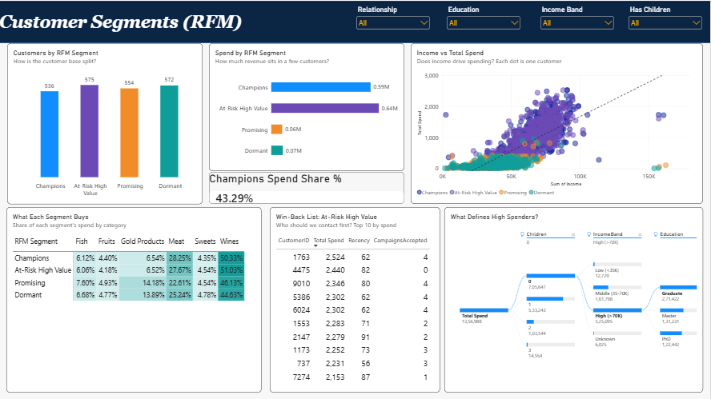

# Customer & Campaign Analytics Dashboard | Power BI

An interactive, three-page Power BI dashboard analyzing **2,240 customers**, six marketing campaigns, product spending, purchasing behavior, and customer value using **RFM (Recency, Frequency, Monetary) segmentation**.

**Business question:** Who are our most valuable customers, which customers respond to marketing campaigns, and where should the business focus its next marketing investment?

## Dashboard Preview

### 1. Customer & Spend Overview


Explores customer demographics, product spending, purchasing channels, customer engagement, and enrollment trends.

### 2. Campaign Performance


Compares campaign acceptance rates and identifies customer characteristics associated with stronger marketing responses.

### 3. Customer Segments (RFM)


Segments customers by recency, frequency, and monetary value to identify high-value customers and win-back opportunities.

## Business Questions Answered

| Dashboard Page | Key Questions |
|---|---|
| Customer & Spend Overview | How large and engaged is the customer base? Which products and channels generate the most spending? Which age groups spend the most? |
| Campaign Performance | Which campaigns perform best? How do income, education, household composition, and purchase recency relate to campaign acceptance? |
| Customer Segments (RFM) | How many Champions, At-Risk High Value, Promising, and Dormant customers exist? Which segments contribute the most revenue, and where are the retention opportunities? |

## Key Insights

- **Total customer spend:** 1,356,988 across 2,240 customers, averaging approximately 606 per customer. The source data does not specify a currency.
- **Product concentration:** Wine contributes approximately 50% of total spend, followed by meat at approximately 28%.
- **Purchase channels:** Store purchases account for approximately 46%, web for 33%, and catalog for 21%.
- **Campaign performance:** The sixth campaign achieved an acceptance rate of approximately 14.9%, outperforming the first five campaigns. Campaign 2 had the weakest acceptance rate at approximately 1.3%.
- **Customer response:** 609 customers, or approximately 27.2% of the customer base, accepted at least one campaign.
- **Income and campaign response:** Higher-income customers showed stronger acceptance of the last campaign than lower- and middle-income groups.
- **Household behavior:** Customers without children had a higher campaign responder rate than customers with children.
- **Purchase recency:** Customers who purchased recently showed stronger campaign response than customers who had been inactive for longer.
- **Revenue concentration:** The Champions segment contributes approximately 43% of total spend, highlighting the importance of retaining high-value customers.

*These findings describe observed patterns in the dataset. They do not establish causation, and differences between customer groups may reflect overlapping characteristics.*

## Dataset

- **Source:** Customer Personality Analysis dataset, originally published on Kaggle.
- **File:** `data/marketing_campaign.csv`
- **Dataset size:** 2,240 customer records.
- **Enrollment period:** July 2012 to June 2014.
- **Data format:** Tab-delimited text file.

The dataset includes customer demographics, income, household composition, product-category spending, purchase-channel activity, website visits, purchase recency, and acceptance indicators for six marketing campaigns.

## Data Cleaning & Transformation — Power Query

Data preparation was performed in Power Query to improve data quality, standardize fields, and prepare the data for analysis.

| Data Quality Issue | Transformation Applied |
|---|---|
| Tab-delimited source file | Configured the delimiter and imported the data correctly |
| Day-month-year dates | Parsed dates using the appropriate `en-GB` culture |
| 24 missing income values | Preserved missing values and classified them under an Unknown income band |
| Extreme income outlier of 666,666 | Set the value to blank rather than assuming a replacement value |
| Three implausible birth years | Set invalid birth-year values to blank and classified the age group as Unknown |
| Inconsistent marital-status labels | Mapped Alone to Single and Absurd/YOLO to Other |
| Inconsistent education labels | Standardized Graduation to Graduate and mapped 2n Cycle to Master's level as an explicit assumption |
| Constant columns with undocumented meaning | Removed `Z_CostContact` and `Z_Revenue` |
| Three records with discount purchases exceeding total purchases | Flagged the records and excluded them from the discount measure |

### Derived Fields

- Age and age group
- Income band
- Customer tenure
- Number of children and teenagers in the household
- Total product spend
- Total purchases
- Number of campaigns accepted
- Customer response and engagement flags
- RFM scores and customer segment labels

## Data Model

A star-schema-oriented model was developed by transforming wide customer and campaign data into analysis-friendly fact tables.

| Table | Purpose |
|---|---|
| `DimCustomer` | Customer demographics, customer-level attributes, segments, and summary metrics |
| `FactSpend` | Customer spending by product category |
| `FactChannel` | Customer purchases by store, web, and catalog channel |
| `FactCampaign` | Customer responses across six marketing campaigns |
| `DimDate` | Calendar table supporting date-based analysis |

The model separates customer attributes from transactional-style analytical facts, supporting more consistent measures and flexible filtering across report pages.

## DAX Highlights

The report includes **25+ measures and five calculated columns**, covering the following analytical areas.

### Customer & Spending Analysis
- Total Customers
- Total Spend
- Average Spend per Customer
- Spend per Purchase
- Category Share %

### Campaign Analytics
- Campaign Acceptance Rate %
- Last Campaign Response %
- Responder Rate %
- Repeat Responders
- Response Lift

### Purchasing Channels & Engagement
- Channel Mix %
- Deal Purchase %
- Average Web Visits per Month

### RFM Customer Segmentation

Customers are scored across three dimensions using quartile-based scores from 1 to 4.

- **Recency (R):** How recently a customer made a purchase.
- **Frequency (F):** How frequently a customer purchases.
- **Monetary (M):** How much a customer spends.

The scores are used to classify customers into four actionable segments:

| Segment | Interpretation | Business Opportunity |
|---|---|---|
| Champions | Recent, frequent, high-spending customers | Retain and reward loyal customers |
| At-Risk High Value | Historically valuable customers who have not purchased recently | Launch targeted re-engagement campaigns |
| Promising | Recent customers with comparatively lower frequency or spend | Encourage repeat purchases and cross-selling |
| Dormant | Customers with low recency and lower overall value | Test cost-effective win-back campaigns |

## Tools & Technologies

- **Power BI Desktop** — dashboard development, visualization, and data modeling
- **Power Query (M)** — data cleaning, transformation, and preparation
- **DAX** — measures, KPIs, campaign analysis, and customer segmentation
- **Data modeling** — dimension and fact tables, relationships, and star-schema principles
- **GitHub** — project documentation, version control, and portfolio presentation

## Repository Structure

```text
Customer-and-Campaign-Analytics-Dashboard/
├── README.md
├── data/
│   └── marketing_campaign.csv
├── powerbi/
│   └── Marketing.pbix
├── scripts/
│   └── 05_DAX_Marketing.dax
└── images/
    ├── 01_customer_spend_overview.png
    ├── 02_campaign_performance.png
    ├── 03_customer_segments.png
    └── README.md
```

## How to Explore the Project

1. Open `powerbi/Marketing.pbix` using Power BI Desktop.
2. Navigate through the three report pages to explore spending patterns, campaign effectiveness, and RFM segments.
3. Review the DAX script in `scripts/05_DAX_Marketing.dax` to understand the key measures and calculations.
4. Refer to the dataset and transformation notes above to understand the data preparation decisions.

## Project Objectives & Learning Outcomes

This project demonstrates practical skills in:

- Preparing and validating real-world customer data.
- Designing analytical data models for Power BI.
- Writing DAX measures for KPIs and comparative analysis.
- Evaluating marketing campaign effectiveness.
- Applying RFM analysis to identify actionable customer segments.
- Translating analytical findings into business recommendations.
- Documenting and maintaining an analytics project using GitHub.

---

**Author:** Gilbert Priscilla

*This project is intended for portfolio and learning purposes. Interpretations and recommendations are based on the supplied dataset and its limitations.*
